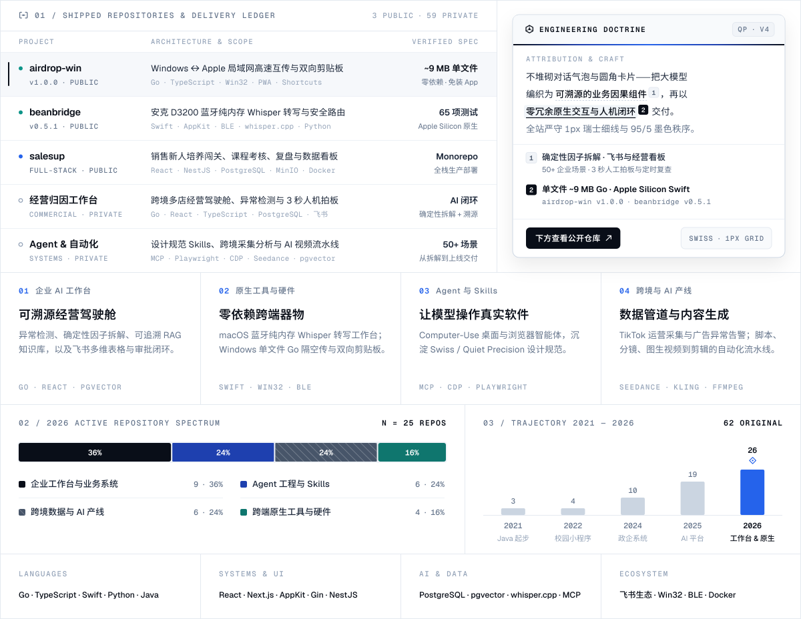

<picture>
  <source media="(prefers-color-scheme: dark)" srcset="./assets/hero-dark.svg">
  <source media="(prefers-color-scheme: light)" srcset="./assets/hero-light.svg">
  
</picture>

<picture>
  <source media="(prefers-color-scheme: dark)" srcset="./assets/workbench-dark.svg">
  <source media="(prefers-color-scheme: light)" srcset="./assets/workbench-light.svg">
  
</picture>

 

### 公开项目 · Public Shipped

| 项目 | 定位 | 核心技术栈 | 交付形态 |
| :--- | :--- | :--- | :--- |
| [**airdrop-win**](https://github.com/sup-lh/airdrop-win) | Windows ↔ iPhone / iPad / Mac 局域网高速互传与双向剪贴板（含截图），手机与 Mac 免装 App | `Go` · `TypeScript` · `Win32` · `PWA` | [v1.0.0](https://github.com/sup-lh/airdrop-win/releases) · ~9 MB 零依赖单文件 |
| [**beanbridge**](https://github.com/sup-lh/beanbridge) | 安克 D3200 录音豆接入 Mac：BLE 常驻、纯内存本地 `whisper.cpp` 转写与防串台安全路由（Codex · 豆包 · Paseo） | `Swift` · `AppKit` · `BLE` · `whisper.cpp` | [v0.5.1](https://github.com/sup-lh/beanbridge/releases) · Apple Silicon 原生 |
| [**salesup**](https://github.com/sup-lh/salesup) | 销售新人培养管理系统：闯关任务、课程考核、知识库、带教复盘与数据看板 | `React` · `NestJS` · `PostgreSQL` · `MinIO` | Monorepo · Docker Compose 部署 |

其余 59 个原创仓库为企业经营工作台（多店驾驶舱与 AI 归因闭环）、跨境数据与 AI 内容产线、企业 AI 落地交付及个人 Agent Design Skills，暂不公开。
