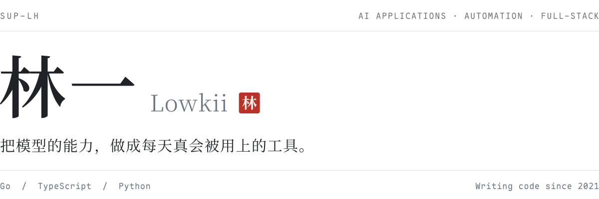

<picture>
  <source media="(prefers-color-scheme: dark)" srcset="./assets/header-dark.svg">
  <source media="(prefers-color-scheme: light)" srcset="./assets/header-light.svg">
  
</picture>

 

我是林一，写代码的人。主要做 AI 应用和自动化工具，从数据库、接口一直做到界面，直到它能交到用户手里。

### 在做

- **AI 内容生产**：把文本、图像、视频的生成串成稳定可控的流程，而不是一次性的 demo。
- **电商经营数据**：把分散在各个平台的数据收拢起来，算成每天打开就能看懂的指标。
- **Agent 与桌面自动化**：让模型去操作真实的软件，替人做重复的活。

### 公开项目

| 项目 | 说明 | 技术 |
| :-- | :-- | :-- |
| [salesup](https://github.com/sup-lh/salesup) | 销售新人培养管理系统：闯关任务、课程考核、带教复盘、转正答辩 | React · NestJS · PostgreSQL · MinIO |

### 常用

<samp>Go · TypeScript · Python</samp>
 
<samp>React · Next.js · NestJS · PostgreSQL · Docker</samp>

 

— Lowkii
