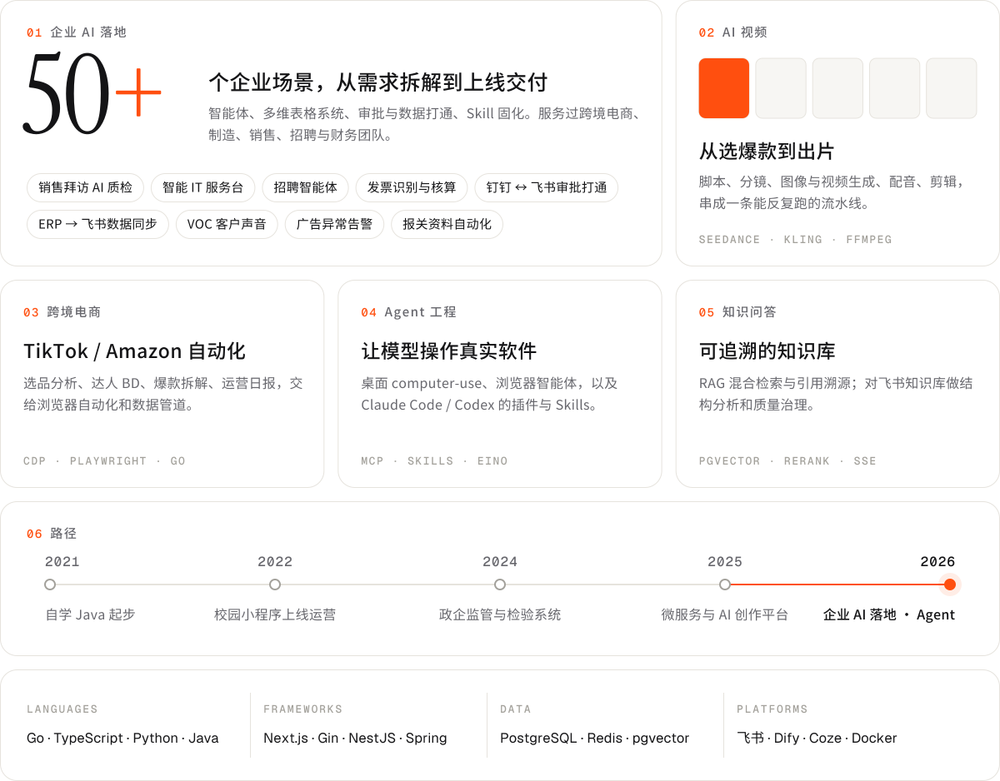

<picture>
  <source media="(prefers-color-scheme: dark)" srcset="./assets/hero-dark.svg">
  <source media="(prefers-color-scheme: light)" srcset="./assets/hero-light.svg">
  
</picture>

<picture>
  <source media="(prefers-color-scheme: dark)" srcset="./assets/bento-dark.svg">
  <source media="(prefers-color-scheme: light)" srcset="./assets/bento-light.svg">
  
</picture>

 

**公开项目**：[salesup](https://github.com/sup-lh/salesup)，销售新人培养管理系统（React · NestJS · PostgreSQL）。其余项目多为客户交付，暂不公开。

Hero 与卡片由 <a href="./scripts/build.py">scripts/build.py</a> 生成，字体为 Instrument Serif、Geist、Noto Sans SC（均为 SIL OFL）。
