<picture>
  <source media="(prefers-color-scheme: dark)" srcset="./assets/hero-dark.svg">
  <source media="(prefers-color-scheme: light)" srcset="./assets/hero-light.svg">
  
</picture>

<picture>
  <source media="(prefers-color-scheme: dark)" srcset="./assets/workbench-dark.svg">
  <source media="(prefers-color-scheme: light)" srcset="./assets/workbench-light.svg">
  
</picture>

 

- [**airdrop-win**](https://github.com/sup-lh/airdrop-win) — Windows ↔ Apple 局域网高速互传与双向剪贴板（~9 MB 纯 Go 单文件 · 免装 App）
- [**beanbridge**](https://github.com/sup-lh/beanbridge) — 安克 D3200 蓝牙纯内存本地 Whisper 转写与安全语音路由（macOS Swift）
- [**salesup**](https://github.com/sup-lh/salesup) — 销售新人培养管理系统（React · NestJS · PostgreSQL）

其余多为企业 AI 工作台与客户交付项目，暂不公开。
